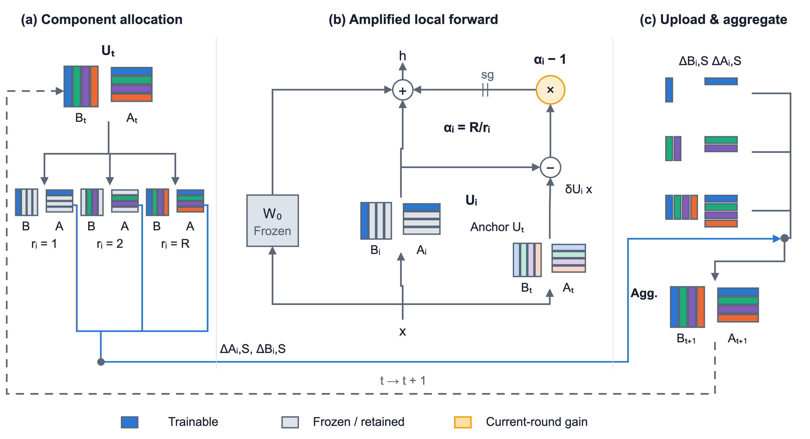

# AmpLoRA · 异构联邦 LoRA 的放大受限训练

**Adaptive Parameter-Efficient Fine-Tuning for Federated Large Models**

客户端只训练和上传部分 LoRA 组件时，怎样保持完整本地训练的精度？本项目研究本地增量放大与按组件聚合，在 RoBERTa-base 和 Qwen2.5-0.5B 的 MNLI 联邦微调中给出实现、配对实验、原始轨迹和复现入口。**AmpLoRA 为论文写作阶段暂名**，早期记录使用 ART / `amp`。

[开始复现](docs/REPRODUCE.md) · [学习指南](docs/LEARNING_GUIDE.md) · [方法与公式](docs/METHOD.md) · [结果与消融](docs/RESULTS.md) · [来源与环境](docs/PROVENANCE.md)

## 研究背景

联邦微调让数据留在客户端，LoRA 降低可训练参数与通信量。设备资源各不相同，因此服务器为弱客户端分配 $r_i$ 个 rank-1 组件，为强客户端保留完整秩 $R$。组件由 $B$ 的一列与 $A$ 的对应行组成。

## 现有工作的不足（动机）

减少训练组件会改变本地优化动态。RoBERTa 的诊断中，完整本地训练后只上传 2/8 组件，核心弱端准确率为 80.17%；直接限制训练组件则降至 77.85%，并出现更大的轮间波动。这使我们把分配、本地训练和服务器聚合分别检验。

## 本文要研究的问题

如何让只训练 $r_i$ 个组件的客户端，以 $r_i/R$ 的 LoRA 因子上传预算，达到“完整训练、相同部分上传”的参照精度？进一步，组件覆盖较密和较稀时，服务器应怎样归一化这些更新？

## 解决该问题的挑战

Adam 的梯度尺度响应、LoRA 的双因子乘积、未选组件的全局状态和跨客户端组件覆盖共同影响训练。实验需要分别控制前向增量与状态草图、停止梯度与真实梯度、放大与学习率补偿，以及 Hájek 与零填充聚合。

## 本文方法与贡献

1. **放大本轮增量。** 前向值使用 $U_t+(R/r_i)(U_i-U_t)$；额外增益停止梯度，原始 LoRA 分支正常反传。未选组件保持本轮全局值。
2. **上传原始因子位移。** 客户端上传所分配组件的未放大 $\Delta A_i,\Delta B_i$，服务器按组件归一化并更新。
3. **覆盖决定聚合配置。** 两个实证设置分别使用 Hájek（RoBERTa）和零填充收缩（Qwen）。代码中显式选择配置；学习文档给出两者的权重计算和收缩解释。
4. **提供可学习的证据链。** 包含三种子主结果、机制对照、消融、逐轮轨迹、Qwen 的版本重放记录，以及从数据准备到重训和表格生成的脚本。



## 主要结果

指标为核心弱客户端的后期平均准确率（%），下表取 seed 2040、2041、2042 的均值。RoBERTa 窗口为第 110–150 轮，Qwen 为第 40–60 轮。

| 模型与弱端预算 | 完整训练、全量上传 | 完整训练、相同部分上传 | AmpLoRA | 聚合 |
|---|---:|---:|---:|---|
| RoBERTa-base，R=8 / r=2 | 80.19 | 80.17 | **80.12** | Hájek |
| Qwen2.5-0.5B，R=64 / r=8 | 82.19 | 80.48 | **80.41** | 零填充收缩 |

两组均为 50 个客户端、每轮参与 10 个、10% 强端、AdamW、本地 20 步。具体 seed、标准差、配对差值及对照见[结果说明](docs/RESULTS.md)。上传比例针对 LoRA 因子；当前实现采用完整 rank 张量加梯度掩码，折叠实现的内存估算单列在[资源口径](docs/PROVENANCE.md)。

## 安装与运行

推荐 Python 3.12。安装适合设备的 PyTorch 2.8.0 后，在仓库根目录运行：

```bash
python -m venv .venv
source .venv/bin/activate
pip install -e '.[test,figures]'

# 离线复算已发布的三份结果表，不下载模型或数据
python scripts/reproduce_results.py

# 准备训练资源与完整重训命令见 docs/REPRODUCE.md
pytest -q
```

复算输出位于 `generated/results/`。完整 GPU 重训在独立的 `.reproduction/` 工作目录进行，使用固定模型版本、官方 MultiNLI 数据和保存的实验配置。详见[复现步骤与实验组](docs/REPRODUCE.md)。

## 仓库导航

| 内容 | 位置 |
|---|---|
| 面向学习与复现的文档 | [docs/](docs/LEARNING_GUIDE.md) |
| 最新方法设计与实验设计底稿 | [docs/designs/](docs/designs/README.md) |
| 训练、模型、分配、聚合、汇总与测试 | [scra/](federated_finetuning/experiments/scra_diagnostics_20261017/scra) |
| 完整秩等基础参照的训练入口 | [headroom/](federated_finetuning/experiments/headroom_coldstart_20261017) |
| 配置、逐轮结果和运行身份 | [federated_finetuning/runs/](federated_finetuning/runs/README.md) |
| 数据准备、实验调度与离线复算 | [scripts/](scripts) |
| 论文提纲、可编辑方法图 | [docs/thesis/](docs/thesis/thesis_outline_2026-10-19.md) |
| 研究演进及旧分支 | [docs/HISTORY.md](docs/HISTORY.md) |

[本次整理验证记录](docs/RELEASE_CHECK.md)：46 项测试通过，三份结果 JSON 完整复算，官方数据分区从零重建通过。

项目状态：核心实验已完成，进入论文与展示整理。算法细节以 `docs/METHOD.md` 和代码为准，实验数字由 `scripts/reproduce_results.py` 从发布轨迹复算。协作规则见 [CONTRIBUTING.md](CONTRIBUTING.md)。
