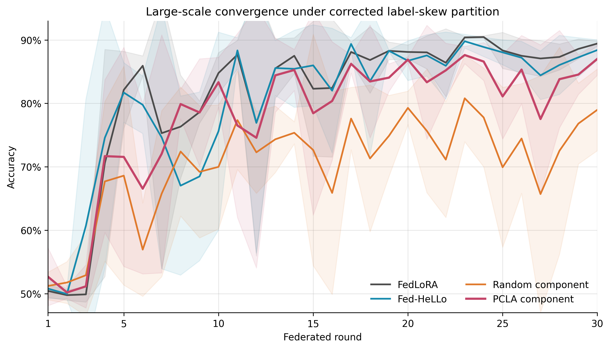
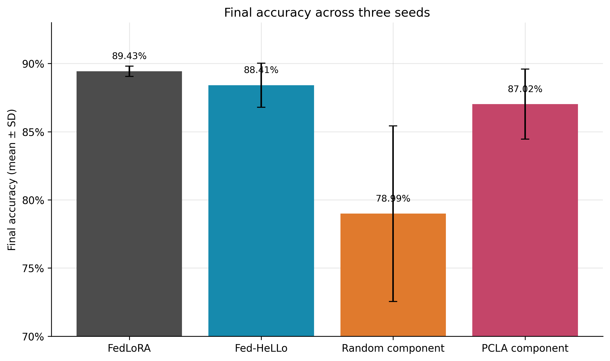
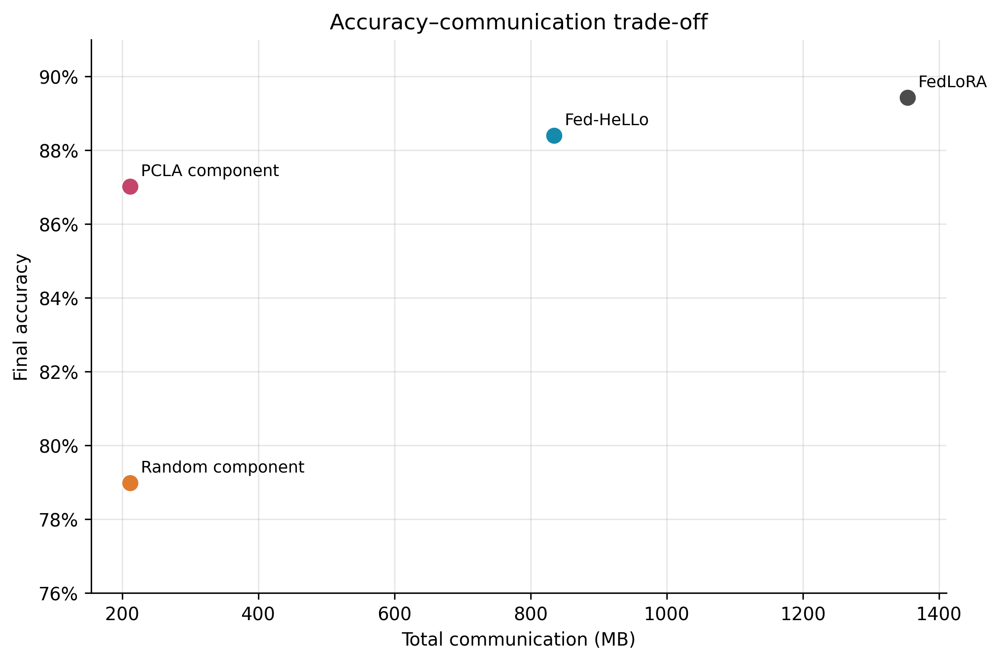

# PCLA：面向异构联邦微调的客户端特定 LoRA 组件分配方法

> 历史方案记录：本文档写于后续聚合诊断之前，其中“只按实际贡献者聚合”等描述反映当时的设计设想，不代表产生现有实验结果的执行版本。当前实现、两批实验设置与结果见[组会问题实验入口](../results/group_meeting_followup_20260924_v1/README.md)和[实际方法说明](../results/group_meeting_followup_20260924_v1/METHODS.md)。

---

## 摘要

本项目研究异构客户端环境下，大语言模型如何以更低的通信和训练成本进行联邦参数高效微调。我们以 LoRA 为基础，设计了 PCLA（Personalized Cost-aware LoRA Allocation）的组件级实现：服务器不再要求每个客户端训练相同的完整 LoRA 参数，而是根据每个客户端自身数据估计不同 LoRA 秩组件的重要性，并在客户端资源容量限制下选择一部分组件进行训练。

当前方法包含五个主要机制：

1. 将 LoRA 更新拆分为对齐的秩组件；
2. 为每个客户端独立估计和维护组件重要性；
3. 在固定资源预算下进行分层、组件级选择；
4. 交替训练 LoRA 的 \(A\) 与 \(B\) 因子；
5. 每个组件只聚合真正更新过它的客户端。

---

## 1. 研究背景

### 1.1 现有异构 LoRA 方法

HetLoRA、FLoRA、Fed-HeLLo 等工作已经研究了客户端 LoRA rank、结构或层数不一致的问题。特别是 Fed-HeLLo 已经结合客户端资源能力和层重要性，为不同客户端分配不同的 LoRA 层。

PCLA 当前的研究定位是：

> 在固定资源与通信预算下，研究客户端特定的 LoRA **组件级边际效用**，以及部分重叠更新下的稳定聚合。

与 FedHeLLo 风格的整层分配相比，PCLA 的主要区别是：

| 维度 | FedHeLLo 风格方法 | 当前 PCLA |
|---|---|---|
| 选择粒度 | LoRA 层 | LoRA rank 组件 |
| 重要性状态 | 主要为层级重要性 | 每个客户端独立维护组件状态 |
| 部分参与 | 选择客户端进行层分配 | 客户端首次参与时初始化，之后持续更新 |
| 聚合 | 异构层级聚合 | 每个组件只聚合实际贡献者 |
| 资源限制 | 可训练层数 | active-layer-equivalent 对应的组件总预算 |

---

## 2. 研究问题与贡献边界

本项目当前回答的核心问题是：

> 能否利用客户端特定的 LoRA 组件边际效用，在严格相同的组件预算下，稳定地超过随机组件分配，并在接近完整或层级 LoRA 准确率的同时显著降低通信量？

当前实现的主要贡献包括：

1. **组件级分配**：把 LoRA rank 拆为对齐的外积组件，而不是把一整层看成不可分割的单位。
2. **客户端特定状态**：每个客户端维护自己的重要性 EMA、选择次数、上次刷新轮次和历史选择。
3. **资源约束选择**：不同资源组只能训练固定数量的层等价组件。
4. **A/B 交替训练**：一轮只更新一个 LoRA 因子，使组件掩码和边际贡献更加清晰。
5. **贡献者聚合**：没有训练某组件的客户端不会稀释该组件的真实更新。
6. **公平对照**：随机组件方法与 PCLA 在每个客户端—轮次上拥有完全相同的资源和通信预算。
7. **数据划分修正**：正式实验在保持客户端异质性的同时严格保存全局标签比例。

需要特别说明：

- “个性化”表示每个客户端使用不同的组件重要性和分配状态；
- “成本感知”目前主要通过硬资源容量和通信预算实现

---

## 3. PCLA 算法原理

### 3.1 LoRA 组件分解

LoRA 的矩阵乘积可以写成多个 rank-1 外积之和：

\[
BA=\sum_{j=1}^{r}b_j a_j^\top
\]

其中：

- \(b_j\) 是 \(B\) 的第 \(j\) 列；
- \(a_j^\top\) 是 \(A\) 的第 \(j\) 行；
- \(b_j a_j^\top\) 是第 \(j\) 个 LoRA rank 组件。

在实现中，一个组件由以下信息唯一确定：

```text
Transformer 层编号 + 投影类型（query/value）+ rank 索引
```

这样不同客户端选择到同一位置时，服务器可以对齐并聚合该组件。

### 3.2 客户端特定的重要性估计

PCLA 使用一个本地 batch 估计组件的一阶边际效用。

当本轮训练 \(B\)、冻结 \(A\) 时：

\[
I^{(B)}_{k,j}
=
\left\|\nabla_{b_j}\mathcal{L}_k\right\|_2
\left\|a_j\right\|_2
\]

当本轮训练 \(A\)、冻结 \(B\) 时：

\[
I^{(A)}_{k,j}
=
\left\|b_j\right\|_2
\left\|\nabla_{a_j}\mathcal{L}_k\right\|_2
\]

其中 \(k\) 表示客户端，\(j\) 表示 rank 组件。query 与 value 投影中对应位置的得分会相加，形成该层对应组件的最终重要性。

直观上，一个组件只有在以下两个条件同时满足时才更值得训练：

1. 当前损失对它的梯度较大；
2. 与它配对但被冻结的另一个因子具有足够大的数值规模。

### 3.3 EMA、探索与新鲜度

单个 batch 的梯度重要性可能有较大噪声，因此先对当前重要性归一化，再使用指数移动平均：

\[
\bar{\mathbf I}_{k,t}
=
\operatorname{Norm}\left(
\rho\bar{\mathbf I}_{k,t^-}
+(1-\rho)\operatorname{Norm}(\mathbf I_{k,t})
\right)
\]

正式实验中 \(\rho=0.8\)。

最终选择分数为：

\[
s_{k,c,t}
=
\operatorname{Std}(\bar I_{k,c,t})
+\beta\sqrt{\frac{\log(t+1)}{N_{k,c,t}+1}}
+\gamma\min\left(
\frac{A_{k,c,t}}{\max(t-1,1)},1
\right)
+\delta\mathbf{1}[c\in M_{k,t^-}]
\]

其中：

- 第一项是标准化后的重要性；
- \(N_{k,c,t}\) 是组件过去被选择的次数；
- 第二项是 UCB 风格探索奖励，避免组件过早被永久淘汰；
- \(A_{k,c,t}\) 是重要性信息的年龄；
- 第三项为长期未刷新的组件提供小幅新鲜度补偿；
- 最后一项可以奖励上一轮已选择组件，从而提高稳定性。

主实验参数为：

```text
beta = 0.5
freshness gamma = 0.05
stability delta = 0
EMA rho = 0.8
refresh interval = 3 rounds
```

客户端第一次被选中时初始化重要性；之后只有当其刷新间隔到期时才重新估计。客户端未参与的轮次不会清空其历史状态。

### 3.4 资源容量约束

设客户端 \(k\) 的资源容量为 \(q_k\)，每个 active-layer-equivalent 对应 \(m=8\) 个组件，则该客户端每轮最多训练：

\[
C_k=q_km
\]

个组件。

主实验中客户端容量为 6、9 或 12 个层等价单位，资源组比例为 6:3:1。

理想化的组件选择问题是：

\[
\max_{\mathbf z_{k,t}}
\sum_c s_{k,c,t}z_{k,c,t}
\]

约束为：

\[
z_{k,c,t}\in\{0,1\},
\qquad
\sum_c z_{k,c,t}\le C_k
\]

### 3.5 分层组件选择

如果直接从全模型选择总分最高的组件，结果可能过度集中在极少数 Transformer 层。PCLA 因此使用两级选择：

1. 对每个 Transformer 层，取该层得分最高的 \(m\) 个组件并计算均值；
2. 根据层得分选择前 \(q_k\) 层；
3. 每个被选中的层至少分配一个组件；
4. 再从这些层内部按组件得分填满剩余预算；
5. 最终总组件数严格等于 \(q_km\)。

该机制同时保留层覆盖和组件级灵活性。

### 3.6 A/B 因子交替训练

PCLA 的稀疏训练轮交替更新两个 LoRA 因子：

```text
奇数轮：训练 B，冻结 A
偶数轮：训练 A，冻结 B
```

掩码只允许被选择组件对应的行或列接收梯度。分类头由所有被选客户端正常训练。

交替训练的优点是：

- 降低单轮可训练参数量；
- 使组件级选择对应到明确的一组可训练参数；
- 让重要性公式可以利用“可训练因子的梯度 × 冻结因子的大小”；
- 便于建立严格预算匹配的随机对照。

### 3.7 仅贡献者聚合

设第 \(t\) 轮实际训练组件 \(c\) 的客户端集合为：

\[
\mathcal C_{c,t}
=
\{k\in\mathcal S_t:z_{k,c,t}=1\}
\]

服务器对该组件执行：

\[
\theta_{c,t+1}
=
\begin{cases}
\dfrac{
\sum_{k\in\mathcal C_{c,t}}n_k\theta_{k,c,t}
}{
\sum_{k\in\mathcal C_{c,t}}n_k
},
& \mathcal C_{c,t}\neq\varnothing\\
\theta_{c,t},
& \mathcal C_{c,t}=\varnothing
\end{cases}
\]

也就是说：

- 训练过组件 \(c\) 的客户端按照本地样本量加权；
- 没有选择组件 \(c\) 的客户端不参与该组件的平均；
- 如果本轮没有客户端训练它，则保留上一轮全局值；
- 分类头仍在所有选中客户端之间进行样本量加权。

如果把未训练组件的客户端也加入普通 FedAvg，它们上传的旧值会稀释真实更新，因此这里必须使用仅贡献者聚合。


---

### 5.3 组件掩码

`LoRALinear` 为 LoRA rank 维度维护 component mask。前向传播时，未被选择的组件会被屏蔽；反向传播时，相应位置不会形成有效更新。

需要注意：当前实现是**逻辑稀疏**，不是专门的稀疏 GPU kernel。虽然只有选定参数参与协议级上传和聚合，但部分底层矩阵运算仍然以 rank 16 的稠密形式执行。

### 5.4 部分参与状态

主实验每轮只选择 20 个客户端中的 10 个，因此不能假设所有客户端在第 1 轮都已经拥有重要性。

当前实现已经支持：

- 客户端第一次出现时估计初始重要性；
- 根据该客户端自己的上次刷新轮次判断是否更新；
- 在未参与轮次中保留 EMA、选择次数与历史掩码；
- 重新参与后继续使用自己的状态，而不是全局统一状态。

3 个 seed 中，全部 20 个客户端最终都获得了有效的重要性状态。PCLA 的刷新客户端—轮次数分别为：

| Seed | 刷新客户端—轮次数 |
|---:|---:|
| 7 | 154 |
| 13 | 157 |
| 21 | 152 |

---

### 6.2 四种核心方法

#### FedLoRA

所有选中客户端训练全部 LoRA 参数。它代表本实验中参数量和通信量最高的准确率参考。

#### FedHeLLo

根据客户端资源容量和层重要性选择完整 LoRA 层进行训练。

这里实现的是**受控 FedHeLLo 机制对比**

#### Random Component Alternating

在与 PCLA 相同的组件预算下随机选择组件，并采用相同的 A/B 交替训练和聚合规则。

#### PCLA Component Alternating

根据每个客户端的组件重要性、探索奖励和新鲜度进行预算内组件分配。

### 6.3 公平性控制

PCLA 与随机组件方法在全部 900 个配对客户端—轮次中严格匹配：

- 同一批参与客户端；
- 相同资源容量；
- 相同 active component 数；
- 相同可训练参数量；
- 相同 A/B 训练因子；
- 相同估算通信量。

因此，二者的主要差异只有：

```text
PCLA：根据客户端重要性选组件
Random：在相同预算下随机选组件
```

这是当前实验中因果解释最清晰的对照。

---

## 7. 通信与时间模型

### 7.1 通信量

每个客户端每轮的通信量估算为：

\[
\operatorname{MB}_{k,t}
=
\frac{2\times4\times P_{k,t}}{2^{20}}
\]

其中：

- \(P_{k,t}\) 是该客户端本轮协议中需要传输的可训练参数量；
- 4 表示 FP32 的每参数字节数；
- 2 表示下载与上传。

该估算假设：

- 预训练 backbone 已经在客户端缓存；
- A/B 交替时被冻结的 LoRA 因子已在客户端缓存；
- 只传输被选择的组件切片和相关可训练参数。


### 7.2 模拟时间

每轮同步时间为最慢客户端的估算时间，加上重要性估计开销：

\[
T_t
=
\max_{k\in\mathcal S_t}
\left(
T^{\text{measured}}_{k,t}f^{\text{compute}}_k
+1.5\operatorname{MB}_{k,t}f^{\text{comm}}_k
\right)
+T^{\text{importance}}_t
\]

该模型包含：

- 本地训练测得时间；
- 客户端异构计算系数；
- 通信量和通信异构系数；
- 同步联邦学习的 straggler 效应；
- PCLA 的重要性估计时间。


---

## 8. 实验结果

### 8.1 三个随机种子的总体结果

| 方法 | 最终准确率 | 最后 5 轮平均 | 全轮平均准确率 | 模拟时间 | 通信量 |
|---|---:|---:|---:|---:|---:|
| FedLoRA | **89.43% ± 0.38%** | **87.98%** | **81.37%** | 314.00 s | 1,353.52 MB |
| FedHeLLo | 88.41% ± 1.61% | 86.67% | 80.30% | 183.89 s | 834.15 MB |
| Random Component | 78.99% ± 6.43% | 73.70% | 70.37% | **73.15 s** | **211.18 MB** |
| PCLA Component | 87.02% ± 2.57% | 83.65% | 78.00% | 100.19 s | **211.18 MB** |


### 8.2 PCLA 与严格预算匹配的随机方法

| 指标 | PCLA 相对 Random 的提升 |
|---|---:|
| 最终准确率 | **+8.03 个百分点** |
| 最后 5 轮平均准确率 | **+9.95 个百分点** |
| 全轮平均准确率 | **+7.62 个百分点** |

逐 seed 的最终准确率：

| Seed | Random Component | PCLA | PCLA - Random |
|---:|---:|---:|---:|
| 7 | 82.79% | 87.50% | **+4.71 pp** |
| 13 | 82.61% | 89.31% | **+6.70 pp** |
| 21 | 71.56% | 84.24% | **+12.68 pp** |

三个 seed 的提升方向完全一致。由于双方资源预算逐客户端、逐轮严格相同，这一结果说明 PCLA 的提升来自重要性引导分配，而不是更多参数、更高通信量或更有利的客户端参与。

### 8.3 PCLA 与 FedHeLLo

PCLA 相对受控 FedHeLLo：

| 指标 | 差异 |
|---|---:|
| 最终准确率 | -1.39 pp |
| 最后 5 轮平均准确率 | -3.02 pp |
| 全轮平均准确率 | -2.30 pp |
| 通信量 | **降低 74.68%** |
| 模拟时间 | **降低 45.52%** |


### 8.4 PCLA 与完整 FedLoRA

PCLA 相对 FedLoRA：

| 指标 | 差异 |
|---|---:|
| 最终准确率 | -2.42 pp |
| 通信量 | **降低 84.40%** |
| 模拟时间 | **降低 68.09%** |


### 8.5 重要性估计开销

PCLA 的重要性估计平均增加：

```text
25.61 秒
```

占 PCLA 总模拟时间：

```text
25.56%
```

这解释了为什么 PCLA 与 Random Component 通信量相同，但模拟时间更长。

---

## 9. 结果图

### 9.1 30 轮收敛曲线



图中可以观察到：

- FedLoRA 整体准确率最高且较稳定；
- FedHeLLo 接近 FedLoRA；
- PCLA 明显高于同预算 Random Component；
- PCLA 在不同 seed 之间仍有一定方差；
- 组件预算越小，早期训练和最终稳定性越容易受客户端异质性影响。

### 9.2 最终准确率



PCLA 没有达到 FedLoRA 和 FedHeLLo 的绝对准确率，但明显弥补了随机稀疏组件训练造成的性能损失。

### 9.3 准确率—通信量关系



PCLA 和 Random Component 位于相同通信预算，但 PCLA 的准确率明显更高。FedLoRA 与 FedHeLLo 使用更多通信取得进一步准确率提升。

---


