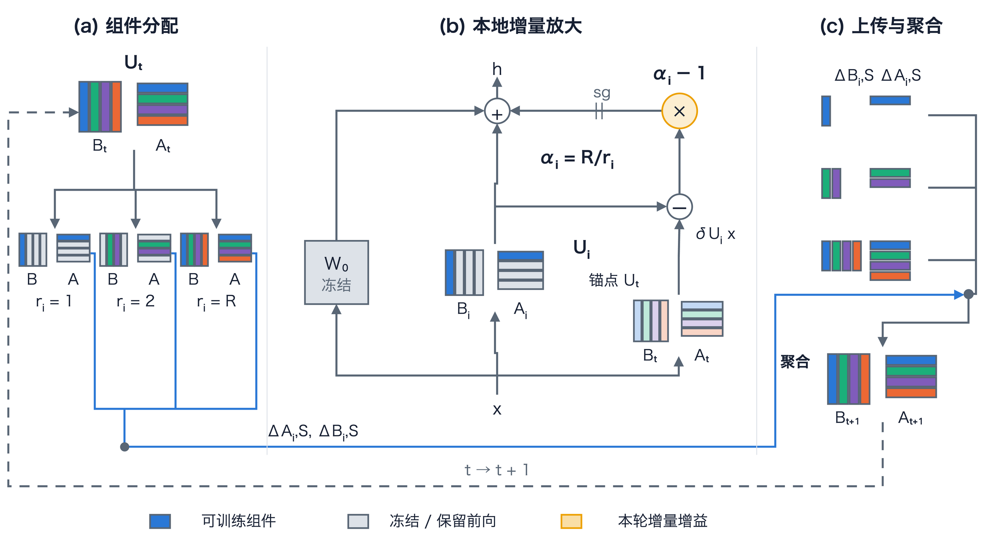
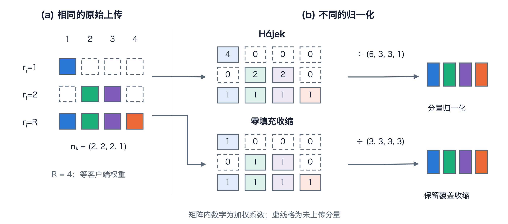

# 论文方法图 v2：组件、前向路径与聚合

2026-10-19。根据已完成的方法图调研（历史来源：`../../figure_design_research_2026-10-19/REPORT.md`）重画。中英文共用几何与组件映射。

## 图 4.1：方法总览



| 版本 | 论文 PDF | 原生 SVG | 可编辑源 |
|---|---|---|---|
| 中文 | [PDF](fig4_1_method_zh.pdf) | [SVG](fig4_1_method_zh.svg) | [Draw.io](fig4_1_method_zh.drawio) |
| English | [PDF](fig4_1_method_en.pdf) | [SVG](fig4_1_method_en.svg) | [Draw.io](fig4_1_method_en.drawio) |

**中文图注。** 异构秩联邦 LoRA 的组件分配、本地放大和原始因子增量聚合。（a）相同颜色对应同一 rank-1 组件，即 B 的一列和 A 的一行；灰色组件固定在全局值并保留在前向中。（b）轮初缓存 Uₜ=BₜAₜ。本地前向包含冻结的 W₀ 路径、当前 Uᵢ=BᵢAᵢ 路径，以及额外增益 (αᵢ−1)sg[(Uᵢ−Uₜ)x]，其中 αᵢ=R/rᵢ，sg 表示停止梯度。因此前向值为 W₀x+[Uₜ+αᵢ(Uᵢ−Uₜ)]x，梯度经原始 Uᵢ 路径传播。（c）本地训练后，仅上传分配组件上的原始因子增量 ΔBᵢ,S、ΔAᵢ,S，由服务器按组件聚合并广播下一轮状态。示意采用 R=4、rᵢ∈{1,2,4}；图中省略共同的 LoRA 乘子及任务头。

**English caption.** Component allocation, amplified local training, and raw factor-update aggregation in heterogeneous-rank federated LoRA. (a) A shared color identifies a rank-1 component: one column of B and its corresponding row of A. Gray components retain their global values in the forward pass. (b) Each round caches Uₜ=BₜAₜ. The local forward combines frozen W₀, current Uᵢ=BᵢAᵢ, and the additional gain (αᵢ−1)sg[(Uᵢ−Uₜ)x], with αᵢ=R/rᵢ and stop-gradient operator sg. Its value is W₀x+[Uₜ+αᵢ(Uᵢ−Uₜ)]x, while gradients pass through the original Uᵢ branch. (c) After local training, clients upload the unamplified changes of their assigned factors. The server aggregates them component-wise and broadcasts the next state. The illustration uses R=4 and rᵢ∈{1,2,4}; the common LoRA scale and task head are omitted.

## 图 4.2：覆盖与归一化



| 版本 | 论文 PDF | 原生 SVG | 可编辑源 |
|---|---|---|---|
| 中文 | [PDF](fig4_2_aggregation_zh.pdf) | [SVG](fig4_2_aggregation_zh.svg) | [Draw.io](fig4_2_aggregation_zh.drawio) |
| English | [PDF](fig4_2_aggregation_en.pdf) | [SVG](fig4_2_aggregation_en.svg) | [Draw.io](fig4_2_aggregation_en.drawio) |

**中文图注。** 相同原始因子增量在 Hájek 与零填充聚合中的不同归一化。示意中三客户端等权，R=4，秩分别为 1、2、4，弱端包含概率为 1/4、1/2，强端为 1。每个有色块代表该组件的一对因子增量，虚线格表示未上传。Hájek 分支以包含概率倒数加权，得到系数矩阵 [[4,0,0,0],[0,2,2,0],[1,1,1,1]]，按列除以 (5,3,3,1)。零填充分支将未上传项记为零，并对全部三客户端取平均，按列除以 (3,3,3,3)。右侧色条表示输出组件身份；长度不编码更新幅度。计算记录见 [aggregation_example.json](aggregation_example.json)。

**English caption.** Different normalization of the same raw factor changes under Hájek and zero-fill aggregation. Three equally weighted clients use ranks 1, 2, and 4 with R=4; their inclusion probabilities are 1/4, 1/2, and 1. Colored cells represent paired factor changes, while dashed cells are unsent. Inverse-inclusion weighting gives coefficients [[4,0,0,0],[0,2,2,0],[1,1,1,1]] and column denominators (5,3,3,1). Zero-fill averaging retains zeros for unsent entries and divides every column by all three participant weights. The output bars identify components; their lengths do not encode update magnitude.

## 编辑与重建

```bash
# 在仓库根目录运行；Python 3.10+ 标准库即可生成全部场景、Draw.io 和原生 SVG。
python docs/thesis/figures/method_v2/build_figures.py

# 可选：安装 Draw.io Desktop 并将 drawio 加入 PATH 后导出 PDF / PNG。
python docs/thesis/figures/method_v2/build_figures.py --export
```

可用 `--language zh` / `--language en`，以及 `--figure overview` / `--figure aggregation` 单独重建。用 `--output-dir /path/to/output` 将重建结果放入其他目录；用 `--drawio-bin /path/to/drawio` 指定 Draw.io Desktop 可执行文件。基础重建无需额外 Python 包、个人技能目录或现有成品。`--export` 调用 Draw.io Desktop 的公开 CLI，生成 PDF 及按 178 mm 宽计算的 400 dpi PNG。PDF 页面使用 Draw.io 的裁切尺寸，在论文中以 `\includegraphics[width=178mm]{...}` 设置排版宽度。已有 PDF 成品为 178 mm 宽。

字体沿用 Arial（英文）和 Hiragino Sans GB（中文）。其他系统可安装相应字体，或在 `Scene.font` 中选择 Noto Sans CJK SC 等本机中文字体；字体选择不改变场景坐标。

- `build_figures.py`：布局、图元、组件映射和双语标签的主源。
- `*.scene.json`：每次构建导出的可检查场景，包含对象、几何和连线语义。
- `*.drawio`：可直接手工移动矩阵、文字和连线的版本。再次运行构建脚本会按主源重建。
- `*.svg`：原生矢量矩形、路径及文字，保留 Draw.io 编辑元数据。
- `*.pdf`：单页矢量论文插图；论文排版时指定 178 mm 宽。
- `*.drawio.png`：400 dpi 预览，内嵌 Draw.io 源。
- `paper-palette.yaml`：四种组件身份色 + 一种增益强调色；浅色锚点由同色派生。
- `academic-style-*.json`：绘图设计记录；重建脚本直接使用本文件内的字号、线宽和字体设置。
- `*.contract.json`：两张图的核心信息、图元含义、示意条件和实现依据。
- `delivery.json`：四份成品的尺寸、格式及统一配色检查记录。

主图、聚合细节图及两种语言绑定本目录同一份配色。

## 设计和语义依据

- [方法设计 §5–§6](../../../designs/algorithm_design_2026-10-18_amplified_restricted.md)：前向值、停止梯度和未放大上传。
- [实现 model.py](../../../../federated_finetuning/experiments/scra_diagnostics_20261017/scra/model.py)：额外增益采用 `.detach()`。
- [实现 core.py](../../../../federated_finetuning/experiments/scra_diagnostics_20261017/scra/core.py)：组件因子位移、异构包含概率加权和零填充聚合。
- 视觉结构参考 Fed-PLoRA 的组件对应、LoRA / VeRA 的局部分支、FLASC 的参数/增量分离；本图为本项目重新制作的原生矢量图，无外部图标。

版面及语义检查见 [validation.md](validation.md)。
