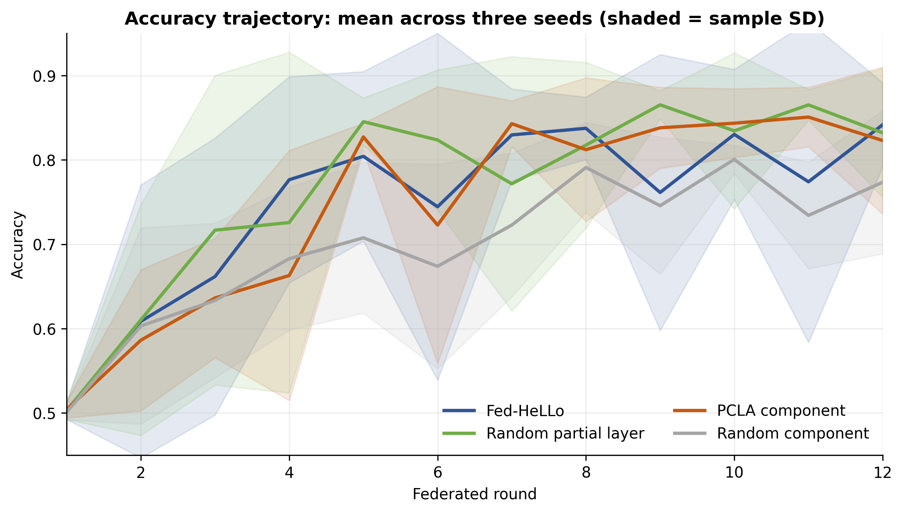
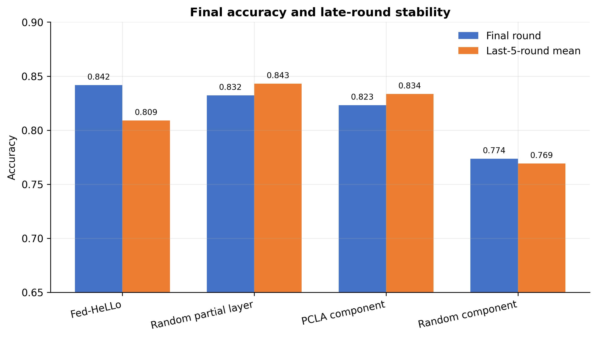
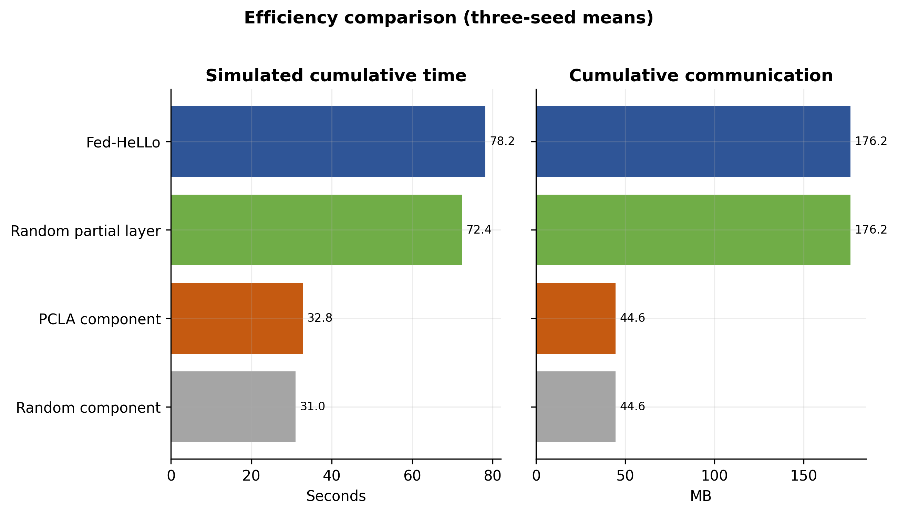
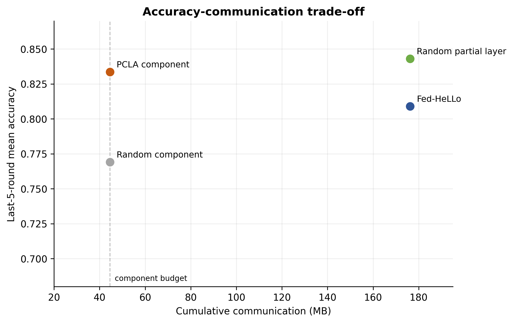

# PCLA component：当前算法、代码实现与实验结果说明

## 1. 我们目前真正要验证的问题

本项目当前不是要重新证明 LoRA 或联邦微调可行，而是研究一个更具体的问题：

> 在客户端数据 Non-IID、设备资源不同的联邦 LoRA 微调中，若每个客户端只能更新很小一部分 LoRA 参数，能否由客户端自己的数据决定“应该更新哪些 LoRA rank components”，并且比同预算的随机选择更有效？

当前主方法是 `pcla_component_alternating`。它的直接对照不是完整 LoRA，而是**通信量、参数预算、交替训练机制完全一致**的 `random_component_alternating`。

---

## 2. 方法是怎样一步步形成的？

项目经历了三个有意义的阶段：

1. **PCLA-v1：clustered layer allocation**  
   用客户端梯度重要性、资源因素和层成本，尝试进行聚类后的 layer selection。该版本发现聚类主要按资源等级分开，没有展示出稳定的数据驱动聚类优势；因此不作为当前主要结果。

2. **online layer selection**  
   去掉显式聚类，改为每个客户端在线维护 layer importance，并尝试 exploration/stability 消融。结果未稳定超过 random partial-layer，因此停止继续调 layer-level score。

3. **PCLA component（当前主线）**  
   将分配单位由“完整 LoRA 层”缩小为“rank component”，同时采用 A/B 交替训练以改善稀疏 LoRA 的聚合一致性。当前实验证明：在完全相同的 component 预算下，importance-guided selection 明显优于 random selection。

这一过程不是简单改超参数，而是根据前一轮实验失败点逐步改变分配粒度和聚合方式。

---

## 3. 当前 PCLA component 算法

### 3.1 分配单位与预算

模型每个 LoRA module 的全局 rank 为 16。对一个容量为 $c$ 的客户端：

- low / medium / high-resource 客户端的 $c$ 分别为 6、9、12 个 layer-equivalent；
- 每个 layer-equivalent 选 8 个 rank components；
- 因此一个客户端一轮共选择 $c \times 8$ 个 components：48、72 或 96 个；
- 奇数稀疏轮只训练 LoRA-$B$，偶数稀疏轮只训练 LoRA-$A$。

这样，PCLA 和随机 component 基线每个客户端、每一轮使用完全一致的 component 数量、可训练参数量和上传预算；两者唯一的差别是 **component 怎么选**。

### 3.2 如何计算每个客户端的 component 重要性

每隔 3 个稀疏训练轮，客户端使用自己的一个本地 mini-batch 估计当前 component 的一阶敏感度。

当本轮训练 $B$ 时，第 $i$ 个 rank component 的分数来自：

$$
\left\|\nabla B_{:,i}\right\|_2 \cdot \left\|A_{i,:}\right\|_2
$$

训练 $A$ 时则对称计算。直觉是：component 的梯度大，且另一因子的尺度也大时，更新该 component 更可能带来较大的 $\Delta W=BA$ 改变。

代码入口是 [`estimate_component_importance`](../../src/fedhello_sst2.py#L1050)。它对 query/value LoRA 的对应 component 分数进行累计。

### 3.3 如何从 importance 变成最终选择

原始 importance 不会直接决定选择。每个客户端维护 component score 的 EMA，并加入探索和新鲜度项：

$$
\text{score}_{i}=\text{standardize}(\text{EMA-importance}_{i})
+ \beta\sqrt{\frac{\log(t+1)}{n_i+1}}
+ \gamma\,\text{freshness}_i
+ \delta\,\mathbf{1}(i\text{ was selected last round})
$$

其中：

- 第二项鼓励尝试较少被选择的 component；
- 第三项避免某些 component 长期没有机会被更新；
- 最后一项是可选的稳定性偏好；本次正式配置中 $\delta=0$，不人为偏好上一轮选择。

算法先根据每层中 top-8 component 的平均分选出 $c$ 个层，再在这些层内选够 $c\times8$ 个 highest-score components。对应实现是 [`select_component_allocation`](../../src/fedhello_sst2.py#L280)。

### 3.4 训练与聚合

```text
第 t 轮开始
  ├─ 若到 importance refresh interval：各客户端用本地数据更新 component EMA
  ├─ 各客户端在自己的预算内选择 components
  ├─ 奇数轮仅训练 B；偶数轮仅训练 A
  ├─ 客户端上传本轮被选 component 的更新
  └─ 服务器只对“实际贡献了该 component”的客户端做加权聚合
```

component-wise aggregation 位于 [`aggregate_component_models`](../../src/fedhello_sst2.py#L1317)。分类器参数仍由所有参与客户端进行 FedAvg；没有贡献某个 component 的客户端不会影响该 component 的聚合值。

---

## 4. 与三种对照方法具体差在哪里？

| 方法 | 选择粒度 | 是否使用本地数据决定选择 | 是否交替训练 A/B | 通信预算 |
|---|---|---:|---:|---:|
| Fed-HeLLo | 完整 LoRA layer | 否；服务器 proxy FIM | 否 | 完整 partial-layer 预算 |
| Random partial layer | 完整 LoRA layer | 否；随机选择 | 否 | 完整 partial-layer 预算 |
| Random component | rank component | 否；随机选择 | 是 | 与 PCLA 相同 |
| **PCLA component** | **rank component** | **是；本地 importance + EMA/exploration** | **是** | **与 Random component 相同** |

因此应当分两层解释结果：

- **PCLA vs Random component**：检验“importance-guided component selection”本身是否有效；
- **PCLA vs Fed-HeLLo / Random partial layer**：检验极低通信预算下，PCLA 离 layer-level 方法还有多远。

---

## 5. 为什么 PCLA 时间短、通信少？

PCLA 的节省来自稀疏 component 训练，而不是改变模型或减少客户端数据：

| 客户端容量 | component 方法本轮选择数 | 本轮可训练参数量 | 单客户端单轮通信量 |
|---:|---:|---:|---:|
| 6 层等价预算 | 48 components | 75,266 | 0.5742 MB |
| 9 层等价预算 | 72 components | 112,130 | 0.8555 MB |
| 12 层等价预算 | 96 components | 148,994 | 1.1367 MB |

相比完整 partial-layer 方法，component 方法：

1. 每轮只激活一部分 rank components；
2. 每轮只训练并传输 $A$ 或 $B$ 中一个因子；
3. 对未被选 component 不做本轮 aggregation；
4. 因而低资源客户端的本地反向传播和通信负担都显著下降。

PCLA 确实多了一项本地 importance 估计开销；该开销已计入总时间。PCLA 比 Random component 略慢（32.79 s vs 31.01 s），正是这部分选择开销的体现；但相比完整 layer 方法仍节省约一半以上的模拟时间。

---

## 6. 实验协议与数据划分修正

当前正式结果采用：

- SST-2 / `bert-base-uncased`；
- 5 个客户端，每客户端 512 条训练样本；
- 12 个联邦轮次，所有客户端每轮参与；
- 3 个 seed：7、13、21；
- Dirichlet $\alpha=0.3$ 的 Non-IID 标签分布；
- 320 条 server proxy 数据与 552 条 evaluation 数据严格分开。

早期实现曾让每个客户端独立抽标签比例，可能导致不同 seed 的客户端总体标签比例偏移。现已改为 constrained Dirichlet：每个 seed 都保持联邦训练集合的总体正类比例与 SST-2 原训练集一致。实现见 [`constrained_dirichlet_positive_counts`](../../src/fedhello_sst2.py#L399)，修正过程见 [数据划分说明](../../docs/DATA_PARTITION_CORRECTION_V1.md)。

---

## 7. 当前结果

| 方法 | Final accuracy | Final SD | Last-5 mean | Round-average | 总模拟时间 | 总通信量 |
|---|---:|---:|---:|---:|---:|---:|
| Fed-HeLLo | 0.8418 | 0.0499 | 0.8091 | 0.7478 | 78.17 s | 176.20 MB |
| Random partial layer | 0.8321 | 0.0763 | 0.8430 | 0.7677 | 72.37 s | 176.20 MB |
| **PCLA component** | **0.8231** | **0.0871** | **0.8336** | **0.7459** | **32.79 s** | **44.58 MB** |
| Random component | 0.7736 | 0.0847 | 0.7691 | 0.6976 | 31.01 s | 44.58 MB |







### 结果应该怎样解读？

**第一，PCLA 的选择策略是有效的。**  
在完全相同的 component 数量和通信量下：

- 最终准确率：0.8231 vs 0.7736，提升 **4.95 个百分点**；
- 末 5 轮均值：0.8336 vs 0.7691，提升 **6.45 个百分点**；
- round-average：0.7459 vs 0.6976，提升 **4.84 个百分点**。

这说明性能提升不能解释为“PCLA 传得更多”或“PCLA 训练了更多参数”，而是来自 component selection policy。

**第二，PCLA 以约四分之一通信量接近 layer-level 方法。**  
PCLA 通信量为 44.58 MB，较 Fed-HeLLo 和 Random partial layer 的 176.20 MB 少 **74.7%**。最终准确率分别低 1.87 和 0.91 个百分点；但 PCLA 的末 5 轮均值比 Fed-HeLLo 高 2.45 个百分点，只比 Random partial layer 低 0.94 个百分点。



---

## 8. 当前结论与下一步的算法空间

### 现在可以给出的结论

> 在修正后的 Non-IID SST-2 联邦设置中，客户端本地 importance-guided component allocation 能在匹配稀疏预算下，稳定优于随机 component allocation；并以约 75% 更少的通信量，取得接近完整 partial-layer 方法的后期准确率。

### 当前方法还不应声称的内容

- 不应说 PCLA 已全面优于 Fed-HeLLo 或 random partial-layer；
- 不应说它已验证跨数据集、跨模型或大规模客户端的普适性；
- 不应说当前 component score 已是严格的 cost-aware optimization：目前成本主要体现为每客户端的预算/容量，不在选择分数中显式优化；
- 不应把当前 component 版本称为 cluster-based personalization：它是 client-specific selection，但没有在本轮正式结果中使用 adapter-similarity cluster aggregation。

### 下一版（PCLA-v2）应解决什么

1. 在 component score 中显式加入训练与通信成本，形成真正的 utility/cost 或 budget-constrained selection；
2. 引入 client update / importance profile 相似度，协调不同客户端的选择，降低聚合冲突；
3. 完成已有配置的 20 客户端、30 轮、3 seed 修正划分实验；
4. 与 LoRA-A²-style adaptive rank selection 做直接消融，明确 PCLA 的增益来自何处。

