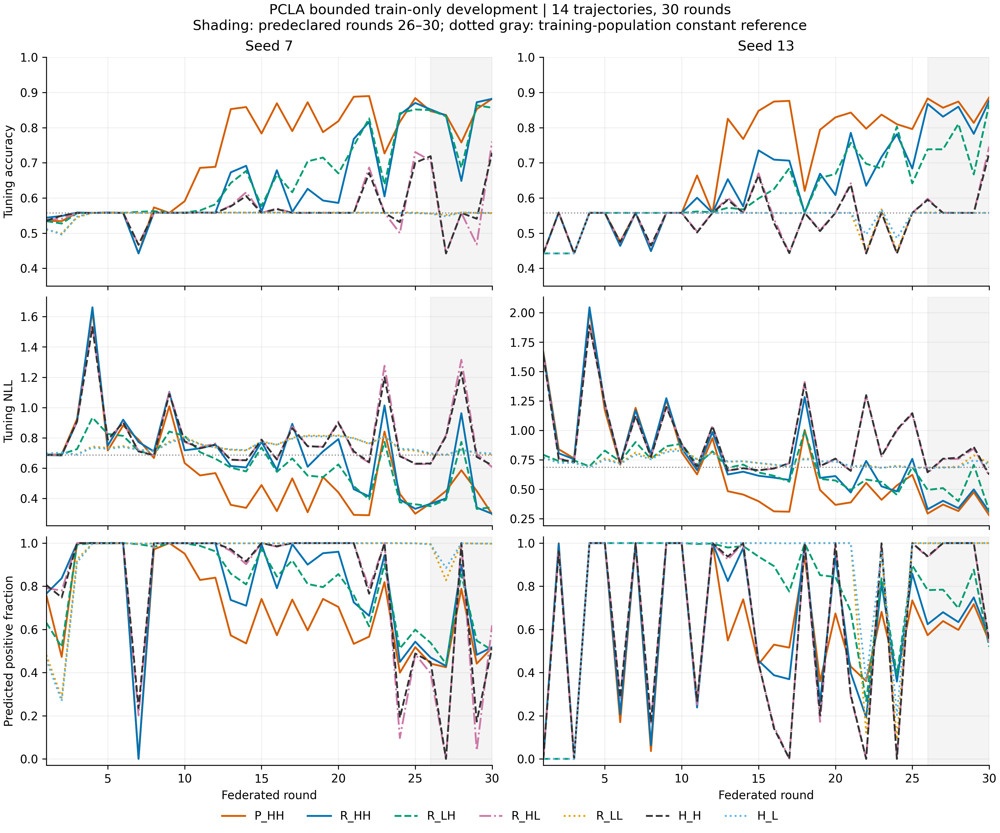

# 训练设置的前期开发

这批实验用于确定后续各方法共用的学习率。早期四轮运行中，多种方法都曾把样本预测为同一个类别，因此我们将观察长度固定为 30 轮，比较分类头和 LoRA 两部分的学习率。

这里的分类头是模型最后负责情感分类的参数；LoRA 是附加在模型上的可训练参数。学习率控制每次更新的步长。七种设置各运行种子 7、13，共 14 次训练、420 轮。评价使用训练数据中留出的 1,024 条样本；[后续核心比较](../../core_shared_hh_20260918_v3/README.md)使用 SST-2 验证集。

## 主要结果

每个种子先取第 26–30 轮平均准确率，再对两个种子取平均。设置名中的 H/L 分别表示 0.001/0.0001，两个字母依次对应分类头和 LoRA。

| 设置 | 含义 | seed 7 | seed 13 | 两种子平均 |
|---|---|---:|---:|---:|
| P_HH | PCLA；分类头与 LoRA 学习率均 0.001 | 83.4961% | 86.2500% | 84.8730% |
| R_HH | 随机整层；两者均 0.001 | 81.7578% | 84.3164% | 83.0371% |
| R_LH | 随机整层；分类头 0.0001、LoRA 0.001 | 81.7383% | 76.4062% | 79.0723% |
| R_HL | 随机整层；分类头 0.001、LoRA 0.0001 | 58.6914% | 60.3320% | 59.5117% |
| R_LL | 随机整层；两者均 0.0001 | 55.6055% | 55.8008% | 55.7031% |
| H_H | 只训练分类头；学习率 0.001 | 59.7656% | 59.8828% | 59.8242% |
| H_L | 只训练分类头；学习率 0.0001 | 55.5469% | 55.7617% | 55.6543% |

在随机整层的四种学习率组合中，两部分均采用 0.001 的平均准确率最高，后续核心比较因此采用这一共享设置。PCLA 与随机整层在 30 轮中都表现出学习信号，完整曲线仍保留了后期波动。

## 固定模型状态的补充检查

另外，从种子 7、只训练分类头方法的第 2 轮模型状态出发，比较参与客户端、数据重新分组和分类头学习率变化，共执行 70 次客户端更新。它们用于检查早期预测集中到单一类别的现象。

[固定状态结果](data/fixed_state_interventions.json)表明，这些变化会影响损失和预测置信度；这项检查没有比较组件分数与单个 rank 更新收益。后续的[评分预测能力诊断](../../rank_signal_20260918_v1/README.md)已单独完成。

## 材料

- [完整 420 轮指标](data/all_round_curves.csv)
- [逐种子结果](data/per_seed_endpoints.csv)
- [原汇总记录](data/development_summary.json)：保留运行结束时的配置建议；后续已采用两部分学习率 0.001。
- [完整曲线 PDF](data/development_curves.pdf)
- [实际配置](../../../configs/pcla_repair/optimization_dev_v2/)
- [14 次运行的原始指标与身份](runs/)

