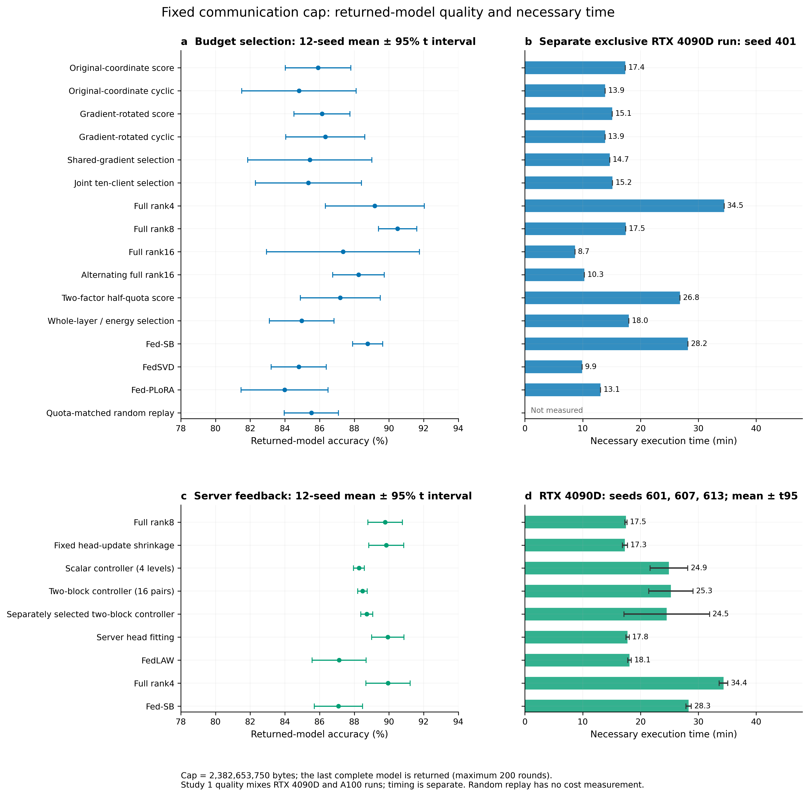
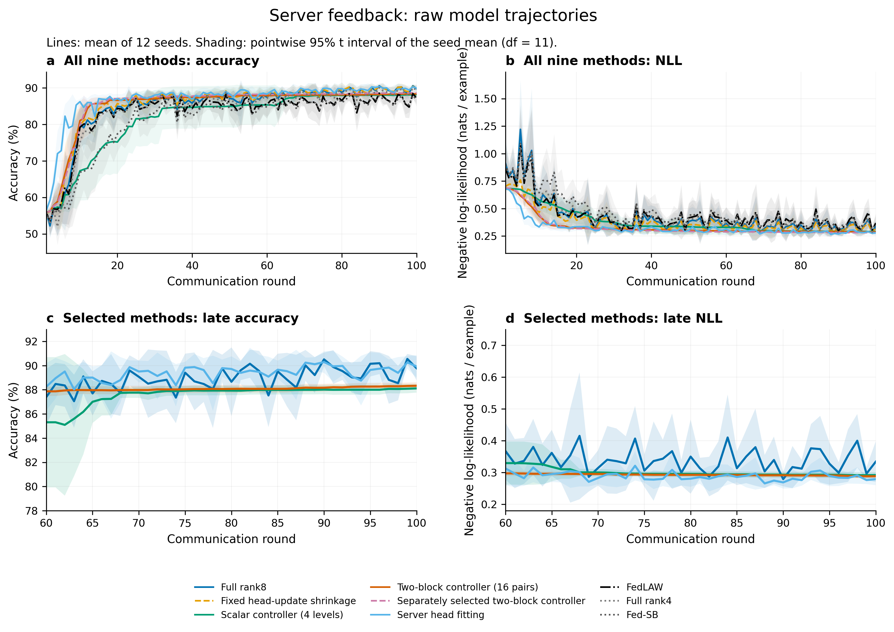
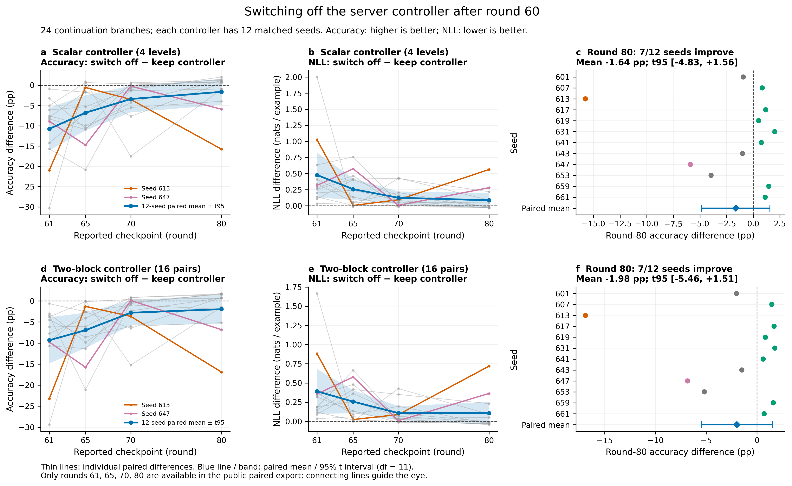

# 固定通信量下的联邦 LoRA：组件选择、服务器控制与关停检验

这个目录是我在 [PR #3](https://github.com/kyotoIndex/pcla-experiments/pull/3) 之后完成的三组实验。PR #3 留下的线索是：每轮用 SVD 重拆 LoRA 以后，PCLA 按分数挑组件开始比随机挑更好。我想知道这条线能不能发展成一个真正有用的方法，于是依次问了三个问题：

| 问题 | 回答 |
|---|---|
| **1. 通信量相同时，挑组件能不能赢过完整 LoRA？** | 不能。挑编号本身有作用：比同名额随机编号高 0.61 个百分点，12 个种子全部同向。但完整 rank8 LoRA 达到 90.50%，最好的挑组件配方低 4.36 个百分点。 |
| **2. 服务器分别控制 LoRA 和分类头的更新幅度，能不能更好？** | 单轮有效，整段训练不行。双系数控制比完整 rank8 低 1.30 个百分点，时间多约 45%。最好的简单做法是在服务器上用少量公共数据训练分类头：准确率与 rank8 持平，损失更低。 |
| **3. 控制器后期大多选择“不更新”，是不是它拦住了学习？** | 不是。从第 60 轮关掉控制器，下一轮准确率在全部 12 个种子上平均掉 9–11 个百分点，之后逐渐恢复，第 80 轮仍略低于保留控制器。 |

SST-2 上的实验到这里全部结束。下面先说明和 PR #3 相比改了哪些设置，再逐部分展开；最后是整个项目目前的情况、我的建议，以及需要你一起决定的两件事。

## 和 PR #3 相比改了什么

模型、数据和联邦设置与 PR #3 相同：BERT-base，SST-2 情感二分类，50 个客户端，标签按 Dirichlet α=0.3 分配，每轮均匀随机抽 10 个客户端参与，客户端本地训练 1 个 epoch（batch 16，共 16 步），使用 AdamW。改变的是比较方式：

| 项目 | PR #3 | 本 PR |
|---|---|---|
| 怎么比 | 固定训练 30 或 100 轮 | 固定通信总额，取额度用完时的最后一个完整模型 |
| 通信额度 | — | 完整 rank8 LoRA 跑 100 轮的实际上传加下载字节数，2,382,653,750 字节（约 2.38 GB）；每轮通信少的方法可以多跑，最多 200 轮 |
| 评价集 | SST-2 官方 dev 集 | 从 SST-2 训练集中按文本去重后留出 4,096 条 |
| 组件 | Q、V 成对的 rank 编号 | 单个投影里 A 的一行或 B 的一列，Q、V 分开选 |
| 流程 | 5 个种子直接比较 | 先用 3–4 个种子开发配方，按事先定好的规则选出方法，再用 12 个新种子验证 |

因为评价集换了，本 PR 的准确率不和 PR #3 的数字直接相比，每部分只在自己内部比较。表里的“配对差”是同一种子下两种方法相减；区间是 12 个种子配对差的 95% t 区间。“损失”指评价集上的平均交叉熵，越低说明模型给出的概率越准。

## 第一部分：通信量相同时，挑组件比不过完整 LoRA

### 怎么做

- **组件和名额：** BERT 的 24 个 Q/V 投影各有 16 个编号，每轮只训练 A 或 B 中的一个。三档客户端每轮分别更新 96、128、192 个位置，参数量与 PR #3 的 48/64/96 对组件相同。
- **开发阶段：** 117 种配方，每种 3 个种子，共 351 条训练。
  - **四种拆法：** 原拆法；逐组件平衡 A、B 尺度；PR #3 的 SVD 重拆；梯度旋转，即按当前客户端的平均梯度旋转坐标，让靠前的编号对准梯度最大的方向。
  - **每种拆法下两种挑法：** 按分数挑，或按顺序轮换编号。学习率和刷新周期也一起比较。
  - **加信息的挑法：** 客户端共享一份压缩梯度摘要再挑；10 个客户端一起决定各自更新哪里。
  - **其他挑法：** 整层或按能量挑；Q/V 绑定；每轮 A、B 各更新一半位置；客户端平均分配名额。
  - **完整 LoRA 和已发表方法：** 完整 rank4/8/16（A、B 同时训练）、完整 rank16 交替训练，以及 Fed-SB、FedSVD、Fed-PLoRA。
- **验证阶段：** 按固定规则选出 16 种方法，每种跑 12 个新种子，共 192 条训练。其中一种是专门的对照：每个模块的名额和“梯度旋转后按分数挑”完全相同，只把挑中的编号换成随机编号，用来单独检验编号挑得准不准。
- **诊断：** 144 个。从完整 rank16 和 rank16 交替训练保存的第 10、60 轮模型出发，让同一批 10 个客户端按不同挑法或拆法真实训练一轮，在另外留出的 2,048 条样本上比较聚合后的效果。
- **计时：** 每种方法用种子 401 在一张独占的 RTX 4090D 上单独完整跑一次。

### 结果

*图 1：上半部分是本节的 16 种方法，下半部分是第二部分的 9 种方法。左边是 12 个种子的平均准确率和 95% 区间，右边是必要执行时间（分钟）。*

| 方法（12 个种子平均） | 准确率 | 返回模型时的轮数 |
|---|---:|---:|
| 完整 rank8 LoRA | **90.50%** | 100 |
| 完整 rank4 LoRA | 89.19% | 198 |
| Fed-SB（200 轮只用了约 27.9% 的通信额度） | 88.77% | 200 |
| 完整 rank16 交替训练 | 88.25% | 71 |
| 完整 rank16 LoRA | 87.35% | 50 |
| 每轮 A、B 各更新一半位置，按分数挑 | 87.19% | 147 |
| 梯度旋转后按顺序轮换编号 | 86.33% | 92 |
| 梯度旋转后按分数挑编号 | 86.14% | 95 |
| 原拆法，按分数挑 | 85.91% | 128 |
| 梯度旋转后，名额不变、编号随机 | 85.52% | 95 |
| 共享梯度摘要后挑 | 85.43% | 91 |
| 10 个客户端一起挑 | 85.36% | 91 |
| 整层或按能量挑 | 84.97% | 147 |
| 原拆法，按顺序轮换 | 84.81% | 95 |
| FedSVD | 84.80% | 66 |
| Fed-PLoRA | 83.98% | 86 |

- **完整 rank8 最好。**
  - 最好的挑组件配方（梯度旋转后按分数挑）比它低 4.36 个百分点，区间 [−6.42, −2.31]，12 个种子里 11 个落后。
  - 完整 rank4 比 rank8 低 1.31 个百分点，区间 [−3.42, +0.79]，但用了约两倍时间。
- **挑编号有真实但很小的作用。**
  - 名额相同时，按分数挑比随机编号高 0.61 个百分点，区间 [0.35, 0.88]，12 个种子全部同向。
  - 简单按顺序轮换编号是 86.33%，和按分数挑相当。这两个配方在开发阶段各自选出了学习率（轮换 1e−3，按分数 3e−4），所以这组比较的是两个完整配方。
- **SVD 重拆在这一设置下没有优势。** 开发阶段各拆法下按分数挑的最好成绩：
  - 原拆法 86.28%；
  - 平衡尺度 86.76%；
  - SVD 83.81%（最低）；
  - 梯度旋转 86.86%。

  按规则，进入验证的是梯度旋转。PR #3 看到的 SVD 优势，是在固定 30 轮、Q/V 成对组件的设置下得到的。
- **rank 不是越大越好。** 完整 rank16 每轮通信是 rank8 的两倍，额度只够跑 50 轮；rank4 能跑 198 轮，但时间翻倍。

### 为什么挑组件起不了作用

诊断把问题拆成了三层：

- **分数预测不准真实收益。**
  - 按梯度算出的“这个位置会带来多少收益”，和客户端真正训练 16 步后的收益，相关只有 0.22；换成完整梯度也只有 0.23。
  - 压缩摘要和完整梯度的排序相关有 0.77，所以问题不在摘要压得太狠。
  - 把试训从 1 步加到 4 步，相关只提高 0.033。
- **更好的组合确实存在，但挑不出来。** 如果让每个客户端把四种挑法都真实训练一遍，再挑聚合效果最好的组合，比按分数挑多降低的损失相当于训练前损失的 24.8%。按顺序轮换也能多降低 16.0%。前者要把客户端训练做四遍，没法直接用。
- **LoRA 和分类头的更新不能简单相加。**
  - 在按分数挑、训练 16 步的诊断里，同时施加两部分的收益，比分别施加的收益之和平均少 0.101，12 个种子全是如此。
  - 9 个种子里，只施加 LoRA 部分比两部分一起施加更好。

  这个现象引出了第二部分。

### 成本

在独占 4090D 上单次完整运行的时间：

| 方法 | 时间 |
|---|---:|
| 梯度旋转后顺序轮换 | 832 秒 |
| 梯度旋转后按分数挑 | 907 秒 |
| 10 个客户端一起挑 | 909 秒 |
| 原拆法按分数挑 | 1,042 秒 |
| 完整 rank8 | 1,047 秒 |
| Fed-SB | 1,692 秒 |
| rank4 | 2,068 秒 |

挑组件的方法省了一些时间，但换不回 4 个多百分点的准确率。

## 第二部分：服务器控制更新幅度，单轮有效，整段训练不行

### 怎么做

以完整 rank8 LoRA 为基础，客户端照常训练 A、B 和分类头。服务器先算普通平均，在施加更新前决定 LoRA 部分和分类头部分各施加多少：用 512 条公共训练数据检查候选模型，选损失最低的那个。

| 做法 | 内容 |
|---|---|
| 完整 rank8 | 普通平均，全部施加 |
| 固定缩小分类头更新 | LoRA 更新全部施加，分类头更新只施加四分之一 |
| 单系数（4 档 / 17 档） | LoRA 和分类头用同一个系数，从 0、1/4、1/2、1 中选，或在 0 到 1 之间每隔 1/16 取值 |
| 双系数 | LoRA 和分类头各取 4 档，从 16 种组合里选 |
| 双系数分别选 | 两个系数沿各自方向单独选，再组合 |
| 服务器上训练分类头 | 普通平均之后，用 512 条公共样本训练分类头 32 步 |
| 其他对照 | 降低客户端分类头学习率、整体固定缩小一半、完整 rank4、Fed-SB，以及服务器端方法 FedLAW、FedExP 的 LoRA 版本 |

- **开发阶段：** 32 种配方，每种 4 个种子，共 128 条训练。FedExP 在开发阶段最好只有 84.70%，没有进入验证。
- **验证阶段：** 9 种方法，每种 12 个新种子，共 108 条训练。
- **诊断：** 120 个。96 个复用第一部分已经训练好的客户端更新，24 个从完整 rank8 第 10、60 轮的模型出发重新训练一轮。每个诊断比较同一批真实更新按不同规则施加后，独立样本上的损失降低多少。
- **事先定好的继续条件：** 双系数比完整 rank8 至少高 1.0 个百分点，比最好的单系数至少高 0.5 个百分点，两个区间下限都大于零；时间不超过 rank8 的 1.5 倍。

### 结果

| 方法（12 个种子平均） | 准确率 | 损失 | 时间 |
|---|---:|---:|---:|
| 完整 rank4 | 89.95% | 0.396 | 2,061 秒 |
| 服务器上训练分类头 | **89.93%** | **0.279** | 1,065 秒 |
| 固定缩小分类头更新 | 89.84% | 0.319 | 1,037 秒 |
| 完整 rank8 | 89.78% | 0.334 | 1,048 秒 |
| 双系数分别选 | 88.72% | 0.280 | 1,472 秒 |
| 双系数 | 88.48% | 0.284 | 1,516 秒 |
| 单系数（4 档） | 88.27% | 0.289 | 1,495 秒 |
| FedLAW | 87.12% | 0.369 | 1,086 秒 |
| Fed-SB（约 27.9% 通信额度） | 87.09% | 0.377 | 1,699 秒 |

时间取三个固定计时种子（601、607、613）在独占 4090D 上的平均。这一批用的是另外 12 个种子，所以完整 rank8 的准确率和第一部分不完全相同。

- **双系数没有达到继续条件。**
  - 它比完整 rank8 低 1.30 个百分点，区间 [−2.49, −0.12]，12 个种子里 10 个落后；比服务器上训练分类头低 1.45 个百分点。
  - 双系数分别选比 rank8 低 1.06 个百分点。
  - 时间约是 rank8 的 1.45 倍。多出的约 470 秒里，约 340 秒是客户端训练：控制器常选“不更新”，下发字节变少，额度内就多跑了几轮。另外约 120 秒是服务器做选择。
- **服务器上训练分类头是最好的简单做法。**
  - 准确率比 rank8 高 0.15 个百分点，区间 [−0.38, +0.68]。
  - 损失低 0.055，区间 [−0.106, −0.004]，12 个种子里 9 个更低。
  - 时间几乎不增加，前提是服务器有少量带标签的公共数据。
- **控制器的损失更低，准确率却更低。** 双系数平均损失 0.284，低于 rank8 的 0.334，准确率却低 1.3 个百分点。

### 为什么单轮收益没有变成最终准确率

**单轮收益几乎全部来自“把整次更新缩小”。** 在完整 rank8 的模型上，同一批真实更新按不同规则施加：

| 和普通平均相比，独立样本上损失多降低 | 平均 |
|---|---:|
| 单系数（4 档） | 0.200 |
| 单系数（17 档） | 0.202 |
| 双系数 | 0.204 |
| 双系数比单系数（17 档）多出的部分 | 0.002，区间跨零 |

这份收益集中在训练早期：双系数相对普通平均，在第 10 轮的模型上多降低 0.379，到第 60 轮只剩 0.029。LoRA 和分类头不能简单相加的现象在 rank8 上也存在（平均 −0.118，12 个种子全为负），但一个系数就拿到了几乎全部收益，第二个系数没有带来实际增量。

**整段训练里，控制器让模型后期停了下来。**

*图 2：上排是 9 种方法第 1–100 轮的准确率和损失，下排放大第 60–100 轮。线是 12 个种子的平均，阴影是 95% 区间。*

| 第几轮（12 个种子平均准确率） | 10 | 60 | 80 | 100 |
|---|---:|---:|---:|---:|
| 完整 rank8 | 80.06% | 87.40% | 88.66% | 89.78% |
| 双系数 | 81.01% | 87.87% | 88.07% | 88.33% |

双系数前期领先，第 60 轮以后基本不动，rank8 继续上升并在第 80 轮前反超。我统计了第 61–100 轮里提交参数和上一轮完全相同的比例，也就是控制器选择“不更新”的比例：

- 单系数 87.3%；
- 双系数 83.5%；
- 双系数分别选 80.0%。

这张表是固定轮数的读数，前面主表是额度用完时的读数；控制器方法常在第 100 轮以后才用完额度，所以两张表的数字略有不同。

## 第三部分：从第 60 轮关掉控制器

### 怎么做

如果控制器后期总选“不更新”是在拦住有用的学习，那么关掉它，模型应该继续进步。为了检验这一点：

- **起点：** 单系数（4 档）和双系数各自 12 个种子保存的第 60 轮完整状态。
- **干预：** 关掉控制器，改用普通平均，再训练 20 轮。数据、参与顺序、学习率、本地步数都和原轨迹相同。
- **对照：** 原来一直开着控制器的第 61–80 轮轨迹。
- **规模：** 共 24 条续训，每个种子的两条在同一张 4090D 上依次运行。

事先定好的判读方式：

| 关掉后的结果 | 说明什么 |
|---|---|
| 准确率和损失都变好 | 控制器拦住了后期学习 |
| 只有准确率变好 | 是两个指标之间的取舍 |
| 没有可分辨的改善 | 这个解释不成立，不再加种子或延长轮数 |

### 结果

*图 3：左、中两列是关掉控制器减去保留控制器的准确率差和损失差，灰线是单个种子，蓝线和阴影是平均值和 95% 区间；右列是第 80 轮每个种子的准确率差。*

| 第几轮 | 单系数：准确率差 | 落后的种子数 | 双系数：准确率差 | 落后的种子数 |
|---|---:|---:|---:|---:|
| 61 | −10.77 个百分点 | 12 | −9.35 个百分点 | 12 |
| 65 | −6.79 | 10 | −6.96 | 12 |
| 70 | −3.40 | 9 | −2.81 | 8 |
| 80 | −1.64，区间 [−4.83, +1.56] | 5 | −1.98，区间 [−5.46, +1.51] | 5 |

第 80 轮时：

- **损失：** 关掉后分别高 0.086（区间 [−0.031, +0.202]）和 0.108（区间 [−0.038, +0.254]）。
- **种子分布：** 两组都有 7 个种子准确率提高、5 个下降。平均值被少数大幅下降的种子拉低，例如种子 613 两组分别下降 15.75 和 16.89 个百分点。

结论有三点：

- **“控制器拦住学习”不成立。** 关掉控制器后，第一次普通平均就让准确率在全部 12 个种子上大幅下降，之后用了约 20 轮才大致恢复。按事先定好的判读方式，这属于没有可分辨的改善。
- **控制器训练出来的模型承受不住一次完整的普通更新。** 后期的“不更新”并不是在错过有用的更新，对这个模型来说，那些更新确实有害。
- **但从头用普通平均训练的完整 rank8，最后反而更好。** 控制器把模型带进了一个“普通更新会伤害它”的状态，再靠拒绝更新把它留在那里。

这一组共 480 轮、4,800 次客户端训练、76,800 次优化器更新。必要执行时间合计 5,086 秒（约 1.4 小时），追加通信 11.25 GB，GPU 运行全部成功。

## 整个项目现在的情况

把 PR #2、PR #3 和本 PR 连起来看：

| 问题 | 结论 | 来源 |
|---|---|---|
| 聚合代码有没有问题 | 没有。联邦训练效果差主要来自客户端标签偏斜和每轮部分参与；分层挑客户端、参数滑动平均能明显改善 | PR #3 |
| PCLA 的分数能不能识别有用的位置 | 能识别一步收益，但和多步真实收益的相关只有约 0.2 | PR #2，本 PR 第一部分 |
| 挑组件对训练有没有帮助 | 有一点：集中式训练里比随机编号高 0.37 个百分点，联邦训练同名额下高 0.61 个百分点 | PR #3，本 PR 第一部分 |
| 挑组件能不能成为更好的方法 | 不能。通信量相同时比完整 rank8 低 4–5 个百分点，按顺序轮换也一样好 | 本 PR 第一部分 |
| 服务器控制更新幅度有没有用 | 单轮有效、长期无效；收益来自缩小步长，一个系数就够 | 本 PR 第二部分 |
| 控制器后期的“不更新”是不是问题 | 不是。关掉后模型先受伤再慢慢恢复 | 本 PR 第三部分 |
| 固定通信量下最好的做法 | 完整 rank8 LoRA；有少量带标签公共数据时，在服务器上训练分类头，准确率持平、损失更低 | 本 PR 第二部分 |

PR #3 末尾提了四条建议，现在的情况是：

- **“SVD 重拆加 PCLA 挑组件”：** 已检验，在固定通信量下没有优势。
- **“确认最终目标是共享模型还是个性化模型”：** 本 PR 都按共享模型评价。个性化只在 PR #3 做过，“共享训练后本地微调一轮”达到 95.29% 本地准确率和 86.07% 平衡准确率。
- **“分层挑客户端或参数滑动平均作为新基线”：** 本 PR 为了和已发表方法公平比较，仍用均匀随机参与，所以这两项还没有在固定通信量下检验。
- **“分块训练和重置优化器的四格对照”：** 没有做。

## 下一步建议

1. **SST-2 上不再加新实验。** 三条方法线都已按事先定好的条件结束，再加种子或调网格不会改变结论。
2. **论文可以开始写。** 我建议中心问题定为“固定通信量下，联邦 LoRA 的哪些改进真的有用”，PCLA 作为其中一章。章节可以这样安排：
   - 问题与设置；
   - 聚合检查与联邦训练波动的来源（PR #3）；
   - 组件挑选：编号选择有作用，整套方法比不过完整 LoRA（PR #2、PR #3、本 PR 第一部分）；
   - 服务器控制：单轮有效、长期无效，以及关停检验（本 PR 第二、三部分）；
   - 成本；
   - 结论。

   三张图可以直接作为实验章节的主图。
3. **如果需要第二个数据集**，最省的做法是只带最强的几种做法（完整 rank8、rank4、服务器上训练分类头，加上单系数和双系数作对照），在 MNLI 上按同样的开发加验证流程重跑，大约 45 条开发训练加 60 条验证训练。PR #3 里已有 AG_NEWS 的结果，可以作为补充。
4. **有余力时可以补一个小实验：** 在固定通信量下比较分层挑客户端和参数滑动平均。它们在 PR #3 里效果很好，还没有和这里的完整 rank8 放在一起比。

## 想请你一起决定的两件事

1. **论文定位。** 原来的题目以 PCLA 为主，按现在的结果更适合写成上面的研究型论文，PCLA 作为其中一章。这一点也需要和博士生确认。
2. **要不要做第二个数据集。** 不做的话，现有结果已经够写一版完整的论文。

## 材料入口

**先看这些：**

| 内容 | 位置 |
|---|---|
| 研究脉络、完成清单、执行记录、写论文时怎么用这些材料 | [HANDOFF.md](HANDOFF.md) |
| 按方法名称浏览全部配方和逐种子结果（下载后用浏览器打开） | [reader/index.html](reader/index.html) |
| 三张图（PNG、矢量 PDF、绘图脚本） | [figures/](figures/README.md) |
| 方法定义、数据切分、参数、统计和计时口径 | [METHODS.md](METHODS.md) |

**查数据：**

| 内容 | 位置 |
|---|---|
| 第一部分：开发阶段 117 种配方和曲线图 | [development/](data/1_budget_selection/development/)，曲线图 [all_recipe_curves.html](data/1_budget_selection/development/all_recipe_curves.html) |
| 第一部分：验证阶段逐种子结果、配对差、逐轮曲线 | [validation/](data/1_budget_selection/validation/) |
| 第一部分：成本与诊断 | [costs/](data/1_budget_selection/costs/)、[diagnostics/](data/1_budget_selection/diagnostics/) |
| 第二部分：开发、验证、控制器每轮记录 | [2_server_feedback/](data/2_server_feedback/) |
| 第二部分：诊断与成本 | [diagnostics/](data/2_server_feedback/diagnostics/)、[costs/](data/2_server_feedback/costs/) |
| 第三部分：逐种子配对结果与成本 | [3_controller_switch_off/](data/3_controller_switch_off/) |
| 每个文件的来源和原始哈希 | [SOURCES.md](SOURCES.md) |

**复现：**

| 内容 | 位置 |
|---|---|
| 实际运行的源码、配置、数据切分清单 | [reproduce/](reproduce/README.md) |
| 428 条实际执行配置的索引 | [INDEX.csv](reproduce/actual_configs/INDEX.csv) |
| 复算本文所有数字 | 在本目录运行 `python3 reproduce/verify_tables.py` |
