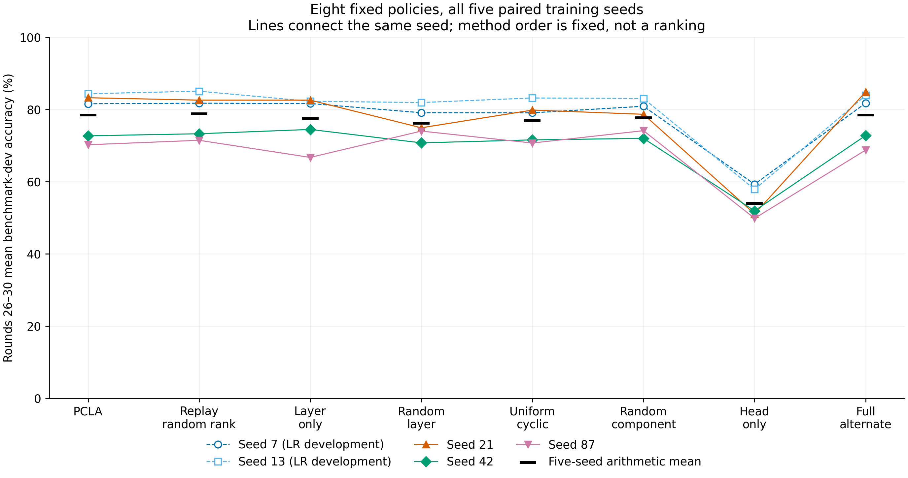

# 层与 rank 选择：五个随机种子的比较

这次实验接着 [Issue #1](https://github.com/kyotoIndex/pcla-experiments/issues/1) 的问题展开：**在更新参数数量相同的情况下，按重要性选择层和层内组件，能带来多少准确率收益？**

八种方法各运行五个随机种子、每次训练 30 轮，40 次训练均已完成。PCLA 的末五轮平均准确率为 **78.40%**；保留 PCLA 的层选择和各层更新数量、随机替换组件编号后，平均准确率为 **78.81%**。具体编号的评分选择在这次比较中没有带来额外的平均准确率收益。

当前进展：完整训练比较与[评分预测能力诊断](../rank_signal_20260918_v1/README.md)均已完成。诊断发现当前归一化评分能识别本地单步收益；完整训练比较显示，这项预测价值尚未转化为相对随机组件编号的额外平均准确率收益。

## 怎么测的

| 项目 | 设置 |
|---|---|
| 模型和任务 | BERT-base；SST-2 句子正负面情感分类 |
| 客户端 | 50 个，每个 256 条训练样本；每轮参与 10 个 |
| 训练 | 30 轮；每个客户端每轮遍历一次本地样本，每批 16 条 |
| 随机种子 | 7、13、21、42、87；用于固定数据划分、模型初始化及客户端参与顺序 |
| 学习率 | LoRA 与分类头均为 0.001；由前一批[开发实验](../_development/optimization_dev_20260918_v2/README.md)确定 |
| 评价数据 | SST-2 验证集的全部 872 条样本，负面 428 条、正面 444 条 |
| 主要读数 | **每个种子先计算第 26–30 轮平均准确率，再对五个种子等权汇总** |

同一种子下，各方法使用相同的数据划分、模型初始化和客户端参与顺序。完整 30 轮曲线保留了训练后期的低谷。

LoRA 用两个小矩阵 A 和 B 表示对基础模型参数的调整。本实验保持基础模型不变，每轮交替更新 A 或 B，从 B 开始。完整 LoRA 都参与模型计算，未选中的组件冻结。客户端同步最新参数；服务器按本轮所有参与客户端的样本量汇总参数增量。

一个“组件”包含同一层 query、value 两个注意力投影中，相同编号的 rank 分量。这里的 rank 编号就是每层 16 个可选分量的位置编号。三档客户端分别更新 48、64、96 个组件；整层方法相应更新 3、4、6 个完整层。分类头是最后负责情感分类的参数，八种方法都更新分类头。

## 方法与结果

| 方法（代码名称） | 做了什么 | 平均准确率 |
|---|---|---:|
| PCLA（`pcla`） | 根据重要性、历史选择次数和距上次更新的时间分配层与组件 | 78.40% |
| 固定层和数量、随机组件编号（`replay_random_rank`） | 使用 PCLA 每轮的层选择和各层组件数量，随机替换编号，重新开始训练 | 78.81% |
| 随机组件（`random`） | 在相同更新预算下随机选择组件 | 77.72% |
| 按重要性选整层（`layer_only`） | 根据各层的组件分数总和选择完整层 | 77.52% |
| 随机选整层（`random_layer`） | 在相同更新预算下随机选择完整层 | 76.12% |
| 均匀轮换组件（`uniform_cyclic`） | 将更新数量尽量均匀分到全部 12 层，再轮换组件编号 | 76.86% |
| 只训练分类头（`head_only`） | LoRA 保持不变，只更新情感分类参数 | 53.98% |
| 更新全部组件（`full_alt`） | 每轮覆盖全部 12 层的 192 个组件，仍交替更新 A、B | 78.40% |

前六种方法的组件更新预算相同，最后两种提供更新范围不同的参照。

PCLA 使用的基础分数是 **normalized projection（归一化投影评分）**：用可训练因子的梯度大小除以配对因子的参数大小，Q、V 两个投影的分数相加。梯度表示损失随参数变化的方向和幅度。在此基础上，PCLA 还结合历史分数与组件更新记录；[具体计算与复现说明](REPRODUCE.md)列出了公式和实现位置。

固定层和数量的随机对照比 PCLA 平均高 0.40 个百分点，五个种子中四个更高。PCLA 相对随机组件平均高 0.68 个百分点，但各种子的差值从 −3.90 到 +4.59 个百分点。完整结果表提供全部七项比较、逐种子差值和区间，便于查看平均值背后的变化。

## 从哪里继续看

| 材料 | 内容 |
|---|---|
| [完整结果与逐种子表](RESULTS.md) | 八种方法、七项 PCLA 配对比较；7/13 与 21/42/87 两组分别列出 |
| [全部曲线 PDF](figures/all_seed_curves.pdf) | 每个种子的 30 轮准确率和损失；灰色区域为第 26–30 轮 |
| [逐轮指标 CSV](data/per_round.csv) | 全部 1,200 轮，方便另行绘图和复算 |
| [成本记录](COSTS.md) | 更新数量、通信量、评分与训练时间，以及随机编号对照的前置费用 |
| [逐层配额检查](data/replay_audit.json) | 1,500 次随机编号客户端更新均保留对应 PCLA 的逐层组件数量 |
| [复现说明](REPRODUCE.md) | 配置、命令、源码与模型版本、数据划分、已有检查 |
| [前期开发实验](../_development/optimization_dev_20260918_v2/README.md) | 学习率如何确定，以及早期训练现象的检查 |

图中每条线连接同一个种子，黑色短横线表示五种子均值。图例中的英文名称对应上表的代码名称；`Replay random rank` 对应固定层和数量的随机编号对照，`Full alternate` 对应交替更新全部组件。

7、13 参与过这次学习率开发，21、42、87 未用于这次学习率选择，因此完整五种子表与两组结果同时提供。评分预测能力的诊断使用客户端训练数据中单独留出的样本，结果另见[诊断说明](../rank_signal_20260918_v1/README.md)。
