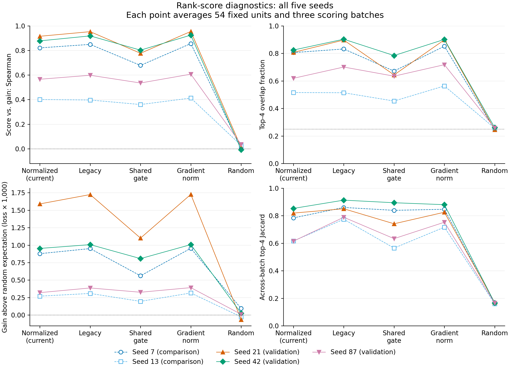

# 重要性分数能否识别更值得更新的组件？

这项诊断接着 [Issue #1](https://github.com/kyotoIndex/pcla-experiments/issues/1) 的另一个问题展开：**在同一个模型状态下，分数较高的组件，更新后是否能让另一批样本上的损失下降更多？**

[五种子完整训练比较](../core_shared_hh_20260918_v3/README.md)已经记录了选择策略的最终效果。本项进一步检查选择器所用的信息：组件间是否存在短期收益差异、评分排序是否稳定，以及分数能否识别这些差异。

**结果：当前归一化分数具有本地单步收益的预测价值。** 在单独报告的 21、42、87 组，评分与收益的 Spearman 排序相关性平均为 **0.7859**，前四名重合比例为 **75.00%**，随机期望为 25%。五个种子中，评分所选位置的平均收益都高于均匀随机选择的期望。

等价缩放后，归一化评分的完整排序在全部检查中保持不变；全五种子的跨批次前四名 Jaccard 平均为 0.7373，跨保存状态为 0.4857。Jaccard 的定义见下文。

与完整训练结果并列看：基础分数能够识别局部短期收益差异，当前完整选择策略相对固定层和数量的随机编号对照，仍没有显示额外的平均准确率收益。

## 怎样测量

使用本次 PCLA 核心训练已经保存的第 **5、15、30 轮**模型状态。每个种子按分配的资源档位各取编号最小的一名客户端，共三名；观察第 1、6、11 层，分别检查更新 LoRA 的 A 或 B 矩阵。

LoRA 用两个矩阵 A、B 的乘积表示参数调整。每层有 16 个 rank 分量；同编号的 query/value 两个注意力投影分量一起作为一个组件。每次只更新一个组件，并保留其余参数。

| 项目 | 设置 |
|---|---|
| 随机种子 | 7、13、21、42、87；前两个用于候选评分比较，后三个单独报告验证结果 |
| 模型状态 | 每个种子的第 5、15、30 轮，共 15 份 |
| 客户端 | 每个资源档位固定一名，三个保存状态共用相同客户端 |
| 观察层 | 第 1、6、11 层，对应代码下标 0、5、10 |
| 更新方向 | 分别更新 A 或 B |
| 比较单元 | 种子 × 保存状态 × 客户端 × 层 × 更新方向，共 270 个 |
| 候选位置 | 每个单元逐一更新全部 16 个位置，共 4,320 次单步更新 |

每个客户端的 256 条训练样本按原始样本编号确定性拆分：三批各 16 条用于评分，一批 16 条用于更新，另一批 64 条用于评价。五组样本互不重叠，同一客户端在不同保存状态和更新方向下共用这份拆分。这些评价样本来自客户端原有训练集，是为本次诊断单独留出的样本；本次诊断不读取 SST-2 验证集。

每个候选位置都从同一份参数开始，使用同一批更新样本，执行一步 AdamW 更新。学习率 0.001、权重衰减 0.01，与核心训练一致。分类头和其他组件冻结。更新时保留训练中的 dropout（随机屏蔽部分信号），并让各候选使用相同随机条件；评分与评价关闭 dropout。

**短期收益 = 更新前损失 − 更新后损失。** 损失在独立的 64 条评价样本上计算，正值表示改善。原始记录保留逐样本损失，可重新计算每个组件的收益。

## 比较哪些分数

梯度表示损失随参数变化的方向和幅度；梯度范数是这些梯度数值的整体大小。下面先以更新 B 为例说明，更新 A 时交换 A、B 的角色。

| 名称 | 计算方式与含义 |
|---|---|
| 当前归一化评分（`normalized_projection`） | B 梯度的大小除以对应 A 行的大小，Q/V 分别计算后相加；这是本轮 PCLA 使用的基础评分 |
| 旧乘法评分（`legacy`） | B 梯度的大小乘以对应 A 行的大小，Q/V 分别计算后相加 |
| 共享 gate 梯度（`gate_shared_qv`） | 给整个 Q/V 组件加同一个乘数 gate，测量损失对该乘数的导数绝对值；先合并 Q/V 的带符号导数，再取绝对值 |
| 梯度范数（`gradient_norm`） | 只看可更新因子的梯度大小，Q/V 分别计算后相加 |
| 随机排序（`random`） | 不使用模型分数，按固定随机顺序选择位置 |

诊断比较的是重新计算的基础分数。完整 PCLA 还对历史分数取移动平均，并加入探索和新鲜度项；这些机制的共同训练效果见核心比较。

## 读数如何解释

- **Spearman / Kendall 排序相关性：** 分数顺序与真实收益顺序的一致程度，正值表示分数越高通常收益越大。
- **前四名重合比例：** 分数前四名与真实收益前四名重合多少，随机选择的期望为 0.25。
- **前四名选择遗憾：** 真实收益最高四个位置的平均收益，减去评分选出四个位置的平均收益。这里平均的是分别更新单个位置的收益。
- **跨批次 Jaccard：** 三批评分样本选出的前四名位置，交集数量除以并集数量。1 表示完全相同。
- **跨模型状态稳定性：** 在相同样本上比较第 5→15、15→30 轮的评分排序与前四名位置。
- **等价缩放检查：** A 的某行乘以 c，B 的对应列除以 c，保持该组件的模型作用不变，检查评分排序是否改变。不同位置的 c 固定取 1/4、1/2、2、4。

随机参照同时保留一次固定随机排序的实际结果，以及均匀随机选择四个位置的精确收益期望。后者等于该单元 16 个单位置收益的平均值。

每个种子先对自己的比较单元等权汇总，再分别汇总 7/13 与 21/42/87。评分或收益完全相同时，排序相关性标为未定义，并保留原因。

## 查看结果与复算

- [完整结果与逐种子汇总](analysis/RESULTS.md)
- [每个比较单元的收益差异](analysis/unit_gains.csv)
- [全部评分与收益指标](analysis/rank_metrics.csv)
- [跨批次稳定性](analysis/batch_stability.csv)与[跨保存状态稳定性](analysis/checkpoint_stability.csv)
- [等价缩放检查](analysis/scaling.csv)
- [原始逐位置读数、模型状态身份和样本划分](raw/)
- [固定诊断设置](protocol.json)与[核验结果](analysis/verification.json)

在仓库根目录复算至新目录：

```bash
python scripts/summarize_rank_signal.py \
  --root results/rank_signal_20260918_v1/raw \
  --out /tmp/pcla-rank-signal-summary
```

执行诊断使用 [diagnose_rank_signal.py](../../scripts/diagnose_rank_signal.py)，数值检查见 [test_rank_signal.py](../../tests_pcla_repair/test_rank_signal.py)。重新执行需要原核心实验的模型状态和训练数据；[获取与版本说明](../core_shared_hh_20260918_v3/REPRODUCE.md)列出了对应信息。

```bash
python scripts/diagnose_rank_signal.py \
  --source-root results/core_shared_hh_20260918_v3 \
  --protocol results/rank_signal_20260918_v1/protocol.json \
  --seed 7 --round 5 --device cuda \
  --out results/rank_signal_reproduction/seed_7/round_5
```

已保存结果保持原样，每次复现实验使用新的输出目录。



图中每条线连接同一个种子，空心点为 7/13，实心点为 21/42/87。`Normalized` 为当前归一化评分，`Legacy` 为旧乘法评分，`Shared gate` 为共享 Q/V gate 梯度，`Gradient norm` 为梯度范数。第三幅图的损失收益乘以 1,000 以便阅读。

[矢量 PDF](figures/rank_signal_by_seed.pdf) · [绘图脚本](../../scripts/plot_rank_signal.py)
